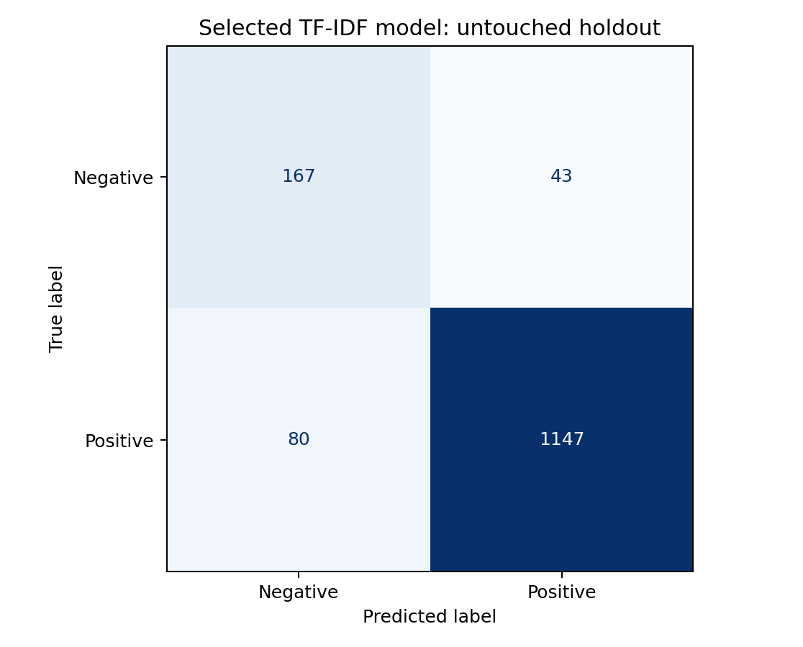

# IE4483 sentiment analysis

A group project for classifying product reviews as negative (`0`) or positive (`1`). The code extends the lecturer's TF-IDF example with model comparison, class weighting, duplicate handling, and a separate holdout evaluation.

Eight configurations were compared using three-fold cross-validation on development data. The selected model combines word and character TF-IDF features with class-weighted logistic regression.

## Recorded results

The experiment used 7,401 labelled reviews. Removing 219 exact case/whitespace-normalised duplicates left 7,182 reviews: 5,745 for development and 1,437 for the holdout.

| Model | Holdout accuracy | Macro-F1 | Negative recall |
|---|---:|---:|---:|
| Default TF-IDF + logistic regression | 89.28% | 0.6934 | 29.52% |
| Word bigram TF-IDF + neural MLP | 91.86% | 0.8129 | 57.14% |
| Word + character TF-IDF, balanced logistic regression | 91.44% | 0.8400 | 79.52% |

Model selection used mean development CV macro-F1 before the holdout was evaluated. Around 85% of the original training labels are positive, so accuracy alone hides poor negative-review detection. The MLP has slightly higher holdout accuracy; the selected model detects more negative reviews.

[Aggregate metrics and experiment settings](results/course-20261013/) are included. These are holdout scores. The supplied test set has no labels, so its accuracy is unknown. The audit also records 101 test reviews matching normalised training text; near-duplicates may remain.



## Setup

Use Python 3.10 or later. The recorded run used Python 3.12.7 and scikit-learn 1.5.1; exact training versions are in `results/course-20261013/experiment.json`.

```sh
python -m venv .venv
# Windows PowerShell:
.venv\Scripts\Activate.ps1
# macOS/Linux: source .venv/bin/activate
python -m pip install -r requirements.txt
```

## Try the synthetic demo

The included demo reviews were written for this prototype. They are not the course dataset, and their scores do not measure assignment performance.

```sh
python sentiment.py train --train data/demo_train.json --output runs/demo-01
python sentiment.py sentence --model-file runs/demo-01/model.joblib --text "The material is comfortable and the quality is excellent."
python sentiment.py predict --model-file runs/demo-01/model.joblib --test data/demo_test.json --template data/demo_submission_template.csv --output runs/demo-01/demo_submission.csv
```

The demo can also be explored with `python -m jupyterlab sentiment_prototype.ipynb`.

## Train on the course dataset

Obtain the Option 1 data from NTULearn and place these files in `data/course/`:

- `train.json`: records containing `reviews` and `sentiments` (0 or 1).
- `test.json`: records containing `reviews`.
- `submission.csv`: the supplied template with `reviews,predictions` columns.

The course files, lecturer notebooks, trained models and review-level outputs are excluded from this public repository. Do not commit them. Notebook outputs have been cleared because they can contain review text.

```sh
python train_course.py --output runs/course-20261013 --seed 42
python -m jupyterlab sentiment_course.ipynb
```

Training fits TF-IDF inside each CV fold, freezes model selection, evaluates the holdout, and refits the winner on all unique training reviews. The final `submission.csv` preserves the supplied test text and row order. The script checks the template against the test file before exporting.

The run folder contains the model, predictions, split membership, metrics and figures. Choose a new output folder for each experiment; existing runs are not overwritten. Use `train_course.py` for course training and export. The older `sentiment.py predict` command uses the demo's ID-based format.

The holdout has now been inspected. Further tuning against it would make its score optimistic; use a new evaluation design for additional model selection. The hotel-review and noisy-label discussion questions still need to be completed in the report.

## Tests

```sh
python -m unittest discover -s tests -v
```

The tests cover data validation, duplicate separation, vocabulary isolation and submission alignment. They run without the course dataset. Local training also verified every exported prediction against a reloaded model.

## Group work

See [CONTRIBUTING.md](CONTRIBUTING.md) for branches, pull requests and GitHub attribution. Add confirmed member roles and evidence to [CONTRIBUTORS.md](CONTRIBUTORS.md). Repository invitations are managed by the owner.

## Acknowledgements

The starting reference is the lecturer-provided `tfidf_features_example.ipynb`. Its rule of fitting TF-IDF only on training data is retained within each evaluation split. Models and preprocessing use [scikit-learn](https://scikit-learn.org/stable/). The initial prototype and training scripts were developed with AI assistance; the group should review the code, verify the results and follow the course's disclosure requirements.
